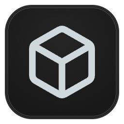

<div align="center">



```text
            _              _   ____            _                 
  __ _ _ __| |_ _ __   ___| |_|___ \__   _____(_) _____      __  
 / _` | '__| __| '_ \ / _ \ __| __) \ \ / / _ \ |/ _ \ \ /\ / /  
| (_| | |  | |_| | | |  __/ |_ / __/ \ V /  __/ |  __/\ V  V /   
 \__,_|_|   \__|_| |_|\___|\__|_____| \_/ \___|_|\___| \_/\_/    
```

**Interactive 3D Lighting Rig & Stage Visualizer for Art-Net 4**  
*Built with Java 21 LTS & JavaFX 3D*

[Features](#features) • [DMX Fixture Profiles](#dmx-fixture-profiles) • [Architecture](#architecture) • [Installation](#installation) • [Build from Source](#build-from-source) • [Releases](https://github.com/exitishere42/artnet2view/releases/latest)

</div>

---

## Features

- **Hardware-Accelerated 3D Stage Visualizer**: Real-time 60+ FPS viewport rendering dark stage floors, modular F34 aluminum trusses, volumetric light cones, and vibrant beam colors with zero texture-upload stalls.
- **3D Transformation Gizmo (X/Y/Z Axis Arrows)**: Select any fixture in the 3D scene to reveal color-coded axis arrows (`X` Red, `Y` Green, `Z` Blue) for direct drag positioning, paired with axis nudge arrows and Pan/Tilt orientation controls in the inspector dock.
- **Portable `.a2v` Project System & Brand Menu (`[ artnet2view ]`)**:
  - Click the top-left logo button to access `Save`, `Save As...`, in-app GitHub `Updates` (with live Markdown release notes and one-click installer), `Fullscreen`, and `Exit`.
  - Clean JSON-based `.a2v` project format storing all fixtures, trusses, 3D transforms, and DMX patches alongside embedded H2 database persistence.
- **Touchpad-Optimized Orbit Navigation**:
  - Multi-touch pinch-to-zoom, damped two-finger scrolling, single-finger orbiting, and multi-modifier panning (`Shift` / `Ctrl` / `Alt` / Right-Click).
  - Quick floating HUD dock (`+`, `-`, `Pan-Modus`, `Reset`) and instant camera presets (`3D`, `Top`, `Front`, `Side`).
- **Art-Net 4 UDP Ingestion**: Lock-free 16-universe receiver listening on UDP port `6454` with live packet telemetry (`FPS` monitor) and built-in **Demo Mode** for offline rig testing.
- **Cross-Platform**: Runs natively on Windows (Direct3D) and Linux (OpenGL / standalone AppImage).
- **Lighting Suite Ecosystem**: Seamless companion to [**jdmx**](https://github.com/exitishere42/JDMX) (DMX Lighting Controller), [**sound2artnet**](https://github.com/exitishere42/sound2artnet) (Sound-to-Light Engine), and [**artnet2dmx**](https://github.com/exitishere42/artnet2dmx) (USB-DMX Bridge).

---

## DMX Fixture Profiles

### U'King ZQ02040 Moving Head Beam (`11CH` / `13CH`)
Moving heads natively follow the **U'King ZQ02040** DMX channel table (`540°` Pan / `270°` Tilt):

```text
+---------+-------------------+---------------------------------------------+
| CHANNEL | FUNCTION          | DESCRIPTION / VALUES                        |
+---------+-------------------+---------------------------------------------+
| CH 1    | Pan Coarse        | Horizontal rotation (0 - 540 degrees)       |
| CH 2    | Pan Fine          | 16-bit Pan fine adjustment                  |
| CH 3    | Tilt Coarse       | Vertical rotation (0 - 270 degrees)         |
| CH 4    | Tilt Fine         | 16-bit Tilt fine adjustment                 |
| CH 5    | Pan/Tilt Speed    | Motor movement speed (fast to slow)         |
| CH 6    | Master Dimmer     | Linear intensity (0 - 255)                  |
| CH 7    | Strobe            | 0-7 Open / Closed, 8-255 Variable Strobe    |
| CH 8    | Red               | Red LED intensity (0 - 255)                 |
| CH 9    | Green             | Green LED intensity (0 - 255)               |
| CH 10   | Blue              | Blue LED intensity (0 - 255)                |
| CH 11   | White             | White LED intensity (0 - 255)               |
| CH 12   | Auto Programs     | (13CH mode) Built-in macro patterns         |
| CH 13   | Reset / Sound     | (13CH mode) Fixture reset / sound control   |
+---------+-------------------+---------------------------------------------+
```

### LED Par 64 & LED Bar
`CH 1` Dimmer • `CH 2` Strobe • `CH 3` Red • `CH 4` Green • `CH 5` Blue • `CH 6` White.

---

## Architecture

```text
+--------------------+      +-------------------------+      +--------------------------+
|   ART-NET 4 / UI   |      |    ARTNET2VIEW CORE     |      |   3D STAGE VISUALIZER    |
|                    |      |                         |      |                          |
|  * UDP Port 6454   | ===> |  * 16x 512-Ch Buffers   | ===> |  * Hardware-Accel 3D     |
|  * Demo Generator  |      |  * ZQ02040 16-Bit Map   |      |  * Volumetric Cones      |
|  * Touchpad Orbit  |      |  * .a2v JSON Projects   |      |  * X/Y/Z Gizmo Arrows    |
|  * Brand Menu      |      |  * H2 / HikariCP Store  |      |  * Live Rig Inspector    |
+--------------------+      +-------------------------+      +--------------------------+
```

For deep dives into packet parsing, buffer concurrency, and 3D scene-graph performance, check [`docs/ARCHITECTURE.md`](docs/ARCHITECTURE.md).

---

## Installation

### Linux One-Liner
```bash
curl -fsSL https://github.com/exitishere42/artnet2view/releases/latest/download/install.sh | bash
```

### Windows
Download and run [`install.bat`](https://github.com/exitishere42/artnet2view/releases/latest/download/install.bat) from the [latest release](https://github.com/exitishere42/artnet2view/releases/latest).

### Standalone AppImage (Linux)
```bash
chmod +x artnet2view-x86_64.AppImage && ./artnet2view-x86_64.AppImage
```

### Uninstall
- **Linux**: `curl -fsSL https://github.com/exitishere42/artnet2view/releases/latest/download/uninstall.sh | bash`
- **Windows**: Run `uninstall.bat` in `%USERPROFILE%\artnet2view`

---

## Build from Source

### Requirements
- **Java 21 LTS** or newer
- **Apache Maven 3.9+**

### Run Application (Development)
On Windows (batch launcher):
```cmd
run.bat
```

Or directly via Maven:
```bash
mvn exec:java
```

### Rebuild AppImage (Linux / WSL)
```bash
mvn clean package -DskipTests
./build-appimage.sh
```

### Compile & Run Tests
```bash
mvn clean test
```

### Build Executable Fat JAR
```bash
mvn clean package
```

The standalone executable fat JAR will be generated at `target/artnet2view-1.2.1-all.jar`.

---

## Author

```text
+-------------------------------------------------------------------+
|  Programmed by:     exitishere42                                  |
|  GitHub:            https://github.com/exitishere42               |
|  Repository:        https://github.com/exitishere42/artnet2view   |
+-------------------------------------------------------------------+
```

## License

GNU General Public License v3.0 (GPL-3.0)
